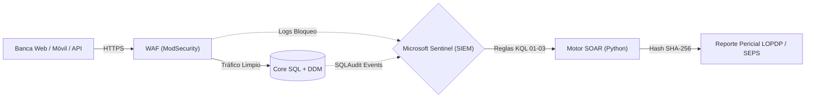

# 🛡️ FinSecOps-EC: Financial Security Operations & Compliance Suite

> **Desarrollado por Damian Fabricio Macancela Caguana**  
> *Estudiante de Ciberseguridad (ITSA) & Estudiante de Derecho (UTPL) · Cuenca, Ecuador 🇪🇨*

<p align="left">
  
  
  
  
  
</p>

Arquitectura integral de **Ingeniería de Detección (Blue Team), Aseguramiento de Bases de Datos y Automatización de Respuesta a Incidentes (SOAR)** diseñada específicamente para el sector financiero (**Bancos y Cooperativas de Ahorro y Crédito**). 

El proyecto resuelve la brecha entre la operación técnica del SOC y el cumplimiento estricto de las normativas ecuatorianas (**SEPS, Superintendencia de Bancos y LOPDP**) bajo el estándar internacional **ISO/IEC 27001:2022**.

---

## 🏗️ Arquitectura de Defensa en Profundidad (Zero Trust)



1. **Perímetro y Canales Digitales (`01-Architecture-and-ZeroTrust`):** Reglas WAF orientadas a mitigar *Credential Stuffing* (`MITRE T1110`), *Account Takeover* y manipulación de parámetros en APIs transaccionales (`OWASP API4:2023`).
2. **Protección del Core Financiero (`02-Database-Hardening-and-DAM`):** Implementación de privilegios mínimos (Zero Trust), deshabilitación de superficies de ataque (`xp_cmdshell`, CLR), auditoría inalterable de transacciones y **Enmascaramiento Dinámico de Datos (T-SQL DDM)** para salvaguardar PII bajo el Art. 40 de la LOPDP.
3. **Ingeniería de Detección en Microsoft Sentinel (`03-SIEM-Detections-KQL`):** Reglas analíticas avanzadas en **KQL (Kusto Query Language)** mapeadas a **MITRE ATT&CK** para correlacionar logins sospechosos desde países de alto riesgo seguidos de transferencias de alto valor, robo de tokens de sesión y exfiltración masiva de clientes.
4. **Automatización SOAR y Cadena de Custodia (`04-SOAR-and-Triage-Automation`):** Motor liviano en Python sin dependencias externas que parsea telemetría bancaria, aplica heurísticas de contención simulada (bloqueo en WAF, suspensión de cuentas, terminación de sesiones SQL) y sella la evidencia con **Hash SHA-256** para garantizar admisibilidad pericial.
5. **Gobernanza y Cumplimiento Legal (`05-GRC-Compliance-Ecuador`):** Matriz de trazabilidad técnica-normativa alineada a la **LOPDP**, resoluciones de riesgo operativo de la **SEPS / Superintendencia de Bancos** y protocolos de preservación de evidencia digital (**ISO 27001 A.5.28**).

---

## 🚀 Demostración Rápida (SOAR Auto-Triage)

Para ejecutar la simulación de detección y respuesta automatizada en tu entorno local:

```bash
# 1. Clonar el repositorio
git clone https://github.com/DamianMacancela/FinSecOps-EC.git
cd FinSecOps-EC

# 2. Ejecutar el motor de triage automatizado (no requiere pip ni dependencias externas)
python 04-SOAR-and-Triage-Automation/soc_auto_triage.py
```

### Salida del Motor de Triage y Cadena de Custodia:


---

## 📊 Mapeo de Reglas KQL Incluidas

| ID Regla | Archivo KQL | Técnica MITRE ATT&CK | Escenario Financiero Detectado | Marco Normativo |
| :--- | :--- | :--- | :--- | :--- |
| **KQL-01** | `01_ImpossibleTravel_Fraud.kql` | `T1078` / `T1550.004` | Inicio de sesión anómalo (Tor / país inusual) seguido de transferencia de alto valor (< 5 min) | Norma SEPS/SB Canales Electrónicos |
| **KQL-02** | `02_MassDataExfiltration_DB.kql` | `T1005` / `T1530` | Extracción masiva (≥ 500 filas) en tablas de clientes/socios del Core Bancario | Art. 40 y 43 LOPDP / ISO 27001 A.8.12 |
| **KQL-03** | `03_PrivilegeEscalation_Core.kql` | `T1098` / `T1543.003` | Adición a grupos privilegiados (`Domain Admins`) o creación de servicios/drivers en servidores Core | ISO 27001 A.8.2 / A.8.9 |

---

## ⚖️ Matriz de Trazabilidad Técnica y Regulatoria (Ecuador)

| Artefacto Técnico en Repo | Técnica MITRE ATT&CK | Control ISO/IEC 27001:2022 | Normativa SEPS / Sup. de Bancos | Ley Orgánica de Protección de Datos (LOPDP) |
| :--- | :--- | :--- | :--- | :--- |
| **`waf-custom-rules.conf`** | `T1110` / `T1190` | **A.8.20** & **A.8.26** | Control de canales electrónicos y prevención de fraude | **Art. 37** Seguridad desde el diseño y por defecto |
| **`core-db-hardening.sql`** | `T1059` / `T1562` | **A.8.9** & **A.8.15** | Pistas de auditoría inalterables en servidores del Core | **Art. 39** Evaluación de impacto en infraestructura crítica |
| **`data-masking-lopdp.sql`** | `T1005` (Insider) | **A.8.11** & **A.5.15** | Segregación de funciones (Soporte N1 vs Producción) | **Art. 40** Seudonimización y enmascaramiento dinámico |
| **`01_ImpossibleTravel_Fraud.kql`** | `T1078` / `T1550.004` | **A.8.16** & **A.5.17** | Monitoreo continuo de patrones de fraude | Protección patrimonial y confidencialidad financiera |
| **`02_MassDataExfiltration_DB.kql`** | `T1530` / `T1005` | **A.8.12** (DLP) | Detección temprana de exfiltración de bases de socios | **Art. 43** Alerta temprana para notificación de brechas |
| **`soc_auto_triage.py`** | Preservación DFIR | **A.5.26** & **A.5.28** | Plan de contingencia ante eventos de riesgo operativo | Integridad probatoria (Hash SHA-256) ante auditoría |

---

## 👤 Autor

* **Damian Fabricio Macancela Caguana**
* *Estudiante de Tecnología Superior en Ciberseguridad* — Instituto Superior Tecnológico del Azuay (ITSA)
* *Estudiante de Derecho* — Universidad Técnica Particular de Loja (UTPL)
* Correo: [damianmacancela@gmail.com](mailto:damianmacancela@gmail.com)
* LinkedIn: [linkedin.com/in/damian-fabricio-macancela-b0a24b3b5](https://www.linkedin.com/in/damian-fabricio-macancela-b0a24b3b5)
* GitHub: [github.com/DamianMacancela](https://github.com/DamianMacancela)

---

## 📄 Licencia

Este proyecto está distribuido bajo la Licencia MIT. Consulta el archivo [LICENSE](LICENSE) para más información.
