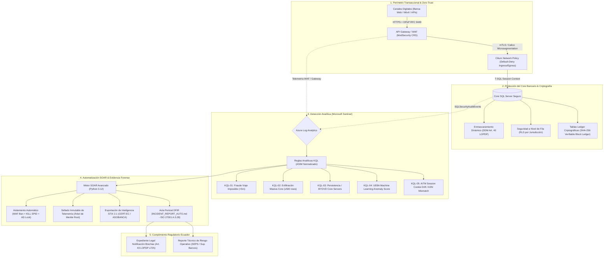
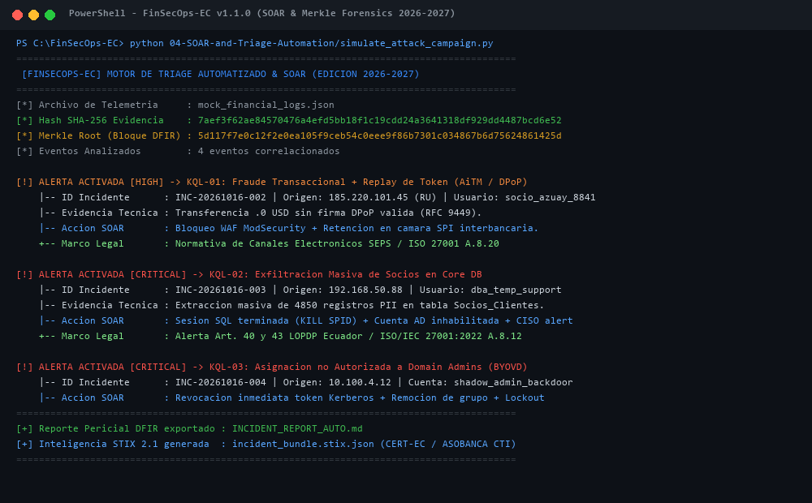

# 🛡️ FinSecOps-EC: Financial Security Operations, Detection Engineering & GRC Suite

> **Desarrollado e Implementado por Damian Fabricio Macancela Caguana**  
> *Estudiante de Tecnología Superior en Ciberseguridad (ITSA) & Estudiante de Derecho (UTPL) · Cuenca, Ecuador 🇪🇨*

<p align="left">
  
  
  
  
  
  
  
  
</p>

---

## 📌 Visión General del Proyecto (Estándares 2026-2027)

**FinSecOps-EC** es una suite integral de **Ingeniería de Detección (Blue Team), Aseguramiento Avanzado de Bases de Datos, Automatización de Respuesta a Incidentes (SOAR) y Gobernanza, Riesgo y Cumplimiento (GRC)** diseñada específicamente para el sector financiero ecuatoriano (**Bancos y Cooperativas de Ahorro y Crédito de los Segmentos 1 y 2**).

El proyecto materializa una arquitectura de **Defensa en Profundidad (Zero Trust Architecture - NIST SP 800-207)** que resuelve la desconexión tradicional entre las operaciones técnicas del SOC y el marco regulatorio vinculante del Ecuador: las Resoluciones de Canales Electrónicos y Riesgo Operativo de la **SEPS y Superintendencia de Bancos**, las directrices de la **Ley Orgánica de Protección de Datos Personales (LOPDP)** y los estándares internacionales **ISO/IEC 27001:2022** y **NIST Cybersecurity Framework 2.0 (CSF 2.0)**.

---

## 🏗️ Arquitectura Técnica de Defensa en Profundidad



---

## 🔬 Las 5 Capas Técnicas Implementadas

### 1. Perímetro, API Security y Microsegmentación Zero Trust
* **OAuth 2.0 DPoP (RFC 9449) & FAPI 2.0 ([`01-Architecture-and-ZeroTrust/dpop-oauth2-hardening.conf`](01-Architecture-and-ZeroTrust/dpop-oauth2-hardening.conf)):**  
  Implementación de validación criptográfica Proof-of-Possession a nivel de aplicación. Los tokens de acceso y refresco están vinculados a la clave privada del dispositivo cliente, neutralizando por diseño ataques de secuestro de sesión y robo de credenciales mediante phishing **Adversary-in-the-Middle (AiTM)**.
* **Microsegmentación Kubernetes / Cilium ([`01-Architecture-and-ZeroTrust/zero-trust-network-policy.yaml`](01-Architecture-and-ZeroTrust/zero-trust-network-policy.yaml)):**  
  Políticas estrictas L4/L7 de aislamiento de contenedores para el Core Banking DB bajo estándar **PCI-DSS v4.0.1 Req 1.2/1.3**. Aplica regla de *Default-Deny Ingress* y *Default-Deny Egress*, bloqueando cualquier movimiento lateral o conexión de Command & Control (C2).
* **Reglas WAF Transaccionales ([`01-Architecture-and-ZeroTrust/waf-custom-rules.conf`](01-Architecture-and-ZeroTrust/waf-custom-rules.conf)):**  
  Mitigación de ataques de fuerza bruta en logins (`MITRE T1110`) y prevención de manipulación de payloads numéricos / montos negativos en transferencias (`OWASP API4:2023`).

### 2. Aseguramiento del Core de Base de Datos y DAM (Database Activity Monitoring)
* **Tablas Criptográficas Ledger ([`02-Database-Hardening-and-DAM/ledger-tamperproof-audit.sql`](02-Database-Hardening-and-DAM/ledger-tamperproof-audit.sql)):**  
  Uso de SQL Server Ledger con libros mayores inmutables basados en árboles de Merkle y bloques SHA-256. Garantiza que ni administradores de base de datos (`sysadmin` / `sa`) puedan alterar balances o transacciones históricas sin que el procedimiento `sp_verify_database_ledger` evidencie la ruptura de integridad forense.
* **Enmascaramiento Dinámico de Datos - DDM ([`02-Database-Hardening-and-DAM/data-masking-lopdp.sql`](02-Database-Hardening-and-DAM/data-masking-lopdp.sql)):**  
  Cumplimiento del **Art. 40 de la LOPDP**. Los datos sensibles de clientes/socios (cédula, correo, cuentas) se enmascaran en tiempo de ejecución para operadores de soporte (`Rol_Soporte_N1`), impidiendo el acceso a datos en claro.
* **Seguridad a Nivel de Fila - RLS ([`02-Database-Hardening-and-DAM/row-level-security-rls.sql`](02-Database-Hardening-and-DAM/row-level-security-rls.sql)):**  
  Segmentación estricta por jurisdicción (*Need-to-Know*): un cajero u oficial de crédito en la agencia Cuenca (Azuay) tiene restringida a nivel de motor SQL la visualización de registros pertenecientes a agencias de Pichincha o Guayas.
* **Hardening CIS Benchmark ([`02-Database-Hardening-and-DAM/core-db-hardening.sql`](02-Database-Hardening-and-DAM/core-db-hardening.sql)):**  
  Deshabilitación obligatoria de `xp_cmdshell`, `clr enabled` y `Ole Automation Procedures` y configuración de auditoría inalterable de servidor.

### 3. Detección Analítica en Microsoft Sentinel (KQL + ASIM + UEBA)
Reglas analíticas de correlación optimizadas para el modelo de información normalizado **ASIM (Advanced Security Information Model)** e Infraestructura como Código (IaC) con plantilla ARM desplegable ([`sentinel-analytic-rules.json`](03-SIEM-Detections-KQL/sentinel-analytic-rules.json)):

| Regla | Archivo KQL | Técnica MITRE ATT&CK | Escenario Detectado | Severidad |
|:---|:---|:---|:---|:---:|
| **KQL-01** | [`01_ImpossibleTravel_Fraud.kql`](03-SIEM-Detections-KQL/01_ImpossibleTravel_Fraud.kql) | `T1078` / `T1550.004` | Acceso exitoso desde país de alto riesgo seguido de transferencia $\ge \$3{,}000$ USD en $<5$ minutos. | **HIGH** |
| **KQL-02** | [`02_MassDataExfiltration_DB.kql`](03-SIEM-Detections-KQL/02_MassDataExfiltration_DB.kql) | `T1005` / `T1530` | Consulta masiva ($\ge 500$ registros de socios) en base de datos transaccional excluyendo servicios aprobados. | **CRITICAL** |
| **KQL-03** | [`03_PrivilegeEscalation_Core.kql`](03-SIEM-Detections-KQL/03_PrivilegeEscalation_Core.kql) | `T1098` / `T1543.003` | Adición a grupos de administración de dominio o instalación de servicios/drivers sospechosos en servidores Core. | **CRITICAL** |
| **KQL-04** | [`04_UEBA_Anomaly_FinancialFraud.kql`](03-SIEM-Detections-KQL/04_UEBA_Anomaly_FinancialFraud.kql) | `T1078.004` (UEBA) | Correlación de anomalías de Machine Learning en Sentinel (`BehaviorAnalytics` Anomaly Score $>75$). | **HIGH** |
| **KQL-05** | [`05_AiTM_SessionHijack_DPoP_Bypass.kql`](03-SIEM-Detections-KQL/05_AiTM_SessionHijack_DPoP_Bypass.kql) | `T1539` / `T1550.004` | Secuestro de sesión por cookie drift: reutilización de session ID con cambio repentino de ASN o país sin reautenticación. | **CRITICAL** |

### 4. Automatización SOAR y Cadena de Custodia Criptográfica (DFIR)
* **Motor SOAR Modular ([`04-SOAR-and-Triage-Automation/soc_auto_triage.py`](04-SOAR-and-Triage-Automation/soc_auto_triage.py)):**  
  Construido en Python moderno (3.10+ / tipado estricto con `dataclasses`) sin dependencias de terceros para entornos de alta seguridad. Aplica heurísticas de contención inmediata (bloqueo dinámico de IP en WAF, invalidación de sesiones Kerberos/OAuth y terminación de sesiones SQL con `KILL SPID`).
* **Sellado de Evidencia con Árbol de Merkle (Merkle Tree Root):**  
  Cada lote de eventos telemetrados es procesado criptográficamente construyendo un árbol de Merkle SHA-256. Esto permite realizar pruebas forenses de inclusión (*Merkle Proofs*) garantizando la inmutabilidad de la prueba digital ante auditorías forenses (**ISO/IEC 27001:2022 Control A.5.28**).
* **Exportación de CTI en STIX 2.1 ([`incident_bundle.stix.json`](04-SOAR-and-Triage-Automation/incident_bundle.stix.json)):**  
  Estandarización de los incidentes en formato OASIS STIX 2.1 para compartición inmediata de inteligencia de amenazas con el **CSIRT de ASOBANCA** y el **CERT-EC**.
* **Simulador de Campaña Ofensiva ([`04-SOAR-and-Triage-Automation/simulate_attack_campaign.py`](04-SOAR-and-Triage-Automation/simulate_attack_campaign.py)):**  
  Script que recrea en 4 etapas un ciberataque de amenaza persistente avanzada (APT) contra el Core Bancario.
* **Suite de Pruebas Automatizadas ([`tests/test_soar_engine.py`](tests/test_soar_engine.py)):**  
  Tests unitarios ejecutables mediante `unittest` (estándar) o `pytest` que verifican la detección de fraude, exfiltración y determinismo de los hashes Merkle.

### 5. Marco de Gobernanza, Riesgo y Cumplimiento (GRC Ecuador)
* **Matriz NIST CSF 2.0 · ISO 27001:2022 · SEPS ([`05-GRC-Compliance-Ecuador/Matriz_NIST_CSF_2.0_ISO27001_SEPS.md`](05-GRC-Compliance-Ecuador/Matriz_NIST_CSF_2.0_ISO27001_SEPS.md)):**  
  Mapeo cruzado de las 6 funciones de NIST 2.0 (**Govern, Identify, Protect, Detect, Respond, Recover**) frente a los 93 controles de ISO 27001:2022 y las resoluciones de riesgo operativo de la SEPS.
* **Evaluación de Impacto en la Protección de Datos - EIPD ([`05-GRC-Compliance-Ecuador/EIPD_Evaluacion_Impacto_Proteccion_Datos.md`](05-GRC-Compliance-Ecuador/EIPD_Evaluacion_Impacto_Proteccion_Datos.md)):**  
  Formalización técnica y jurídica conforme a la Guía Oficial de la **Superintendencia de Protección de Datos Personales (SPDP)** para sistemas transaccionales y scoring bancario.
* **Protocolo de Notificación de Brechas ([`05-GRC-Compliance-Ecuador/Protocolo_Cadena_Custodia_DFIR.md`](05-GRC-Compliance-Ecuador/Protocolo_Cadena_Custodia_DFIR.md)):**  
  Procedimiento legal y pericial para la notificación obligatoria a la SPDP en el término de $\le 72$ horas (Art. 43 LOPDP).

---

## 🚀 Demostración Rápida y Reproducción Local

Para ejecutar la simulación de ataque y la respuesta automatizada SOAR en cualquier máquina con Windows, Linux o macOS:

```bash
# 1. Clonar el repositorio
git clone https://github.com/DamianMacancela/FinSecOps-EC.git
cd FinSecOps-EC

# 2. Ejecutar la suite de pruebas unitarias (0 dependencias externas)
python -m unittest tests/test_soar_engine.py -v

# 3. Simular una campaña completa de ciberataque y disparar el triage SOAR
python 04-SOAR-and-Triage-Automation/simulate_attack_campaign.py
```

### Evidencia de Ejecución en Consola (SOAR & Merkle Forensics):


---

## ⚙️ Pipeline DevSecOps CI/CD (`.github/workflows/secops-ci.yml`)

El proyecto integra integración continua automatizada con GitHub Actions que valida en cada commit:
1. Ejecución de pruebas unitarias forenses (`unittest`).
2. Generación y validación de sintaxis canónica de inteligencia STIX 2.1.
3. Análisis estático de seguridad de código (**SAST**) con `bandit`.
4. Escaneo automatizado de secretos e higiene del repositorio.

---

## 👤 Autor

* **Damian Fabricio Macancela Caguana**
* *Estudiante de Tecnología Superior en Ciberseguridad* — Instituto Superior Tecnológico del Azuay (ITSA)
* *Estudiante de Derecho* — Universidad Técnica Particular de Loja (UTPL)
* 📍 Cuenca, Ecuador 🇪🇨
* 📧 Correo: [damianmacancela@gmail.com](mailto:damianmacancela@gmail.com)
* 💼 LinkedIn: [linkedin.com/in/damian-fabricio-macancela-b0a24b3b5](https://www.linkedin.com/in/damian-fabricio-macancela-b0a24b3b5)
* 🐙 GitHub: [github.com/DamianMacancela](https://github.com/DamianMacancela)

---

## 📄 Licencia

Este proyecto está distribuido bajo la [Licencia MIT](LICENSE).
